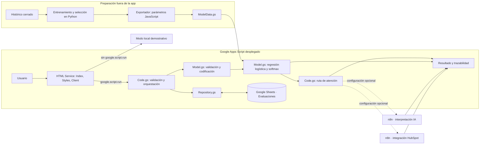

# Onboarding Risk

Prototipo de intake que estima el nivel de riesgo de un proyecto nuevo y propone una ruta inicial de atención. La predicción del despliegue se calcula en el servidor de Google Apps Script (V8) con una regresión logística entrenada previamente en Python. El resultado y su trazabilidad se guardan en Google Sheets. Dos workflows opcionales de n8n pueden interpretar el resultado con un agente y registrar una acción en HubSpot.

> Es un prototipo de apoyo a la decisión. El modelo no alcanza la meta exploratoria de macro-F1 > 0,80, sus probabilidades no están calibradas y el resultado requiere revisión humana. La ruta de atención no es una decisión automática irrevocable.

## Flujo en una frase

El formulario recoge 13 variables del proyecto; `Client.html` envía los datos con `google.script.run`; `Code.gs` valida, llama a `Model.gs`, guarda en Sheets, solicita interpretación/CRM a n8n si está configurado y devuelve el resultado a la interfaz.

## Arquitectura



El detalle y el recorrido entre funciones están en [`docs/arquitectura.md`](docs/arquitectura.md) y [`docs/guia-del-codigo.md`](docs/guia-del-codigo.md).

## Carpetas importantes

| Ruta | Función |
| --- | --- |
| `frontend/src/` | Fuente del formulario, componentes/vistas y estilos para desarrollo local. Agregar comentarios aquí; los artefactos HTML de Apps Script se generan desde esta fuente. |
| `apps-script/` | Archivos que se copian/despliegan en el editor de Google Apps Script. Incluye backend, HTML generado, modelo exportado y manifiesto. |
| `scripts/export_apps_script_model.py` | Exporta los coeficientes/escalas/categorías del modelo de 13 campos y genera los casos de paridad para ambas plataformas. |
| `apps-script/scripts/sync-build.mjs` | Copia los bundles Vite generados a `Styles.html` y `Client.html`. |
| `tests/model-parity.mjs` | Compara la inferencia JavaScript con las respuestas de referencia generadas desde Python. |
| `docs/` | Arquitectura, decisiones técnicas y guía de despliegue. |
| `node-api/` | Experimento previo de predicción por API; no es el despliegue vigente ni participa en la arquitectura actual. |

## ¿Dónde pasa cada cosa?

- **Captura, navegación, validación visual, resumen, historial y resultado:** `frontend/src/main.js` (fuente) y su artefacto `apps-script/Client.html`.
- **Construcción del objeto con las 13 variables del modelo:** `frontend/src/model-input.js`, función `buildModelInput`.
- **Puente front-end → servidor:** función `gasRequest` invoca `google.script.run.submitEvaluation` o `google.script.run.listEvaluations`.
- **Punto de entrada web:** `apps-script/Code.gs`, funciones `doGet` e `include`.
- **Orquestación de una evaluación:** `submitEvaluation` valida metadatos, llama a la predicción, determina ruta, registra el evento, pide la interpretación/acción opcionales y entrega el objeto final.
- **Predicción real:** `apps-script/Model.gs`, función `predictRisk_`. Lee coeficientes en `ModelData.gs`; no llama a una API.
- **Explicación con agente:** `apps-script/Integrations.gs`, función `interpretWithN8n_`. Envía un resumen con riesgo y metadatos generales; si no hay configuración/error, usa texto de respaldo.
- **CRM:** `executeCrmWithN8n_` envía el resultado al webhook n8n configurado para HubSpot. La clave privada de HubSpot permanece en n8n.
- **Histórico:** funciones de `apps-script/Repository.gs` escriben y actualizan la pestaña `Evaluaciones` en el Google Sheet configurado.

## Requisitos para desarrollo local

- Node.js y pnpm.
- Python del entorno del proyecto para regenerar parámetros del modelo.
- Clasp para descargar y subir archivos de Apps Script (se autentica con la cuenta Google propietaria del proyecto).

Desde la raíz de este proyecto:

```powershell
pnpm install
pnpm dev
pnpm build
pnpm test:model
```

El modo local de Vite **no** ejecuta el modelo ni consulta el histórico real; muestra datos y respuesta de demostración. Para evaluación real hay que abrir la implementación web de Apps Script.

### Sincronizar con Google Apps Script

1. Autenticarse en Clasp con la cuenta Google que tiene acceso al proyecto.
2. Crear localmente `apps-script/.clasp.json` usando el Script ID del proyecto (este archivo está excluido de Git).
3. Descargar la versión remota antes de trabajar (`clasp pull`) y revisar los cambios frente al repositorio.
4. Para cambiar la interfaz, editar `frontend/src/` y ejecutar `pnpm build`; no editar directamente `Client.html` o `Styles.html`, pues son generados.
5. Para cambiar la lógica, editar `.gs` en `apps-script/`.
6. Subir los archivos con `clasp push`, revisar/guardar en el editor y publicar una nueva versión de la implementación web cuando corresponda.

La configuración de `SPREADSHEET_ID`, `N8N_AGENT_URL`, `N8N_AGENT_TOKEN`, `N8N_CRM_URL` y `N8N_CRM_TOKEN` vive en **Script Properties** de Apps Script, no en el repositorio. Las variables n8n son opcionales. Consulta [`docs/despliegue-sin-api.md`](docs/despliegue-sin-api.md) y [`apps-script/README.md`](apps-script/README.md).

## Prueba de equivalencia

```powershell
pnpm test:model
```

La prueba usa cuatro entradas de referencia del exportador y comprueba clases y probabilidades de Python contra Apps Script/JavaScript. La función remota `testInstalledModel()` comprueba el mismo contrato dentro de GAS sin escribir en Sheets ni llamar webhooks. No reemplaza una evaluación de producto, seguridad, sesgo ni utilidad de negocio.

## Datos y secretos excluidos de Git

El repositorio debe contener solo el código del proyecto y la documentación técnica necesaria: no subir el CSV histórico, notebooks con datos/resultados, credenciales, tokens, `.clasprc.json`, `.clasp.json`, `node_modules`, builds intermedios, entornos virtuales, modelos Python binarios, copias de respaldo ni capturas de ejecuciones reales. Revisa `git status` y `git diff --cached` antes de cada commit.
