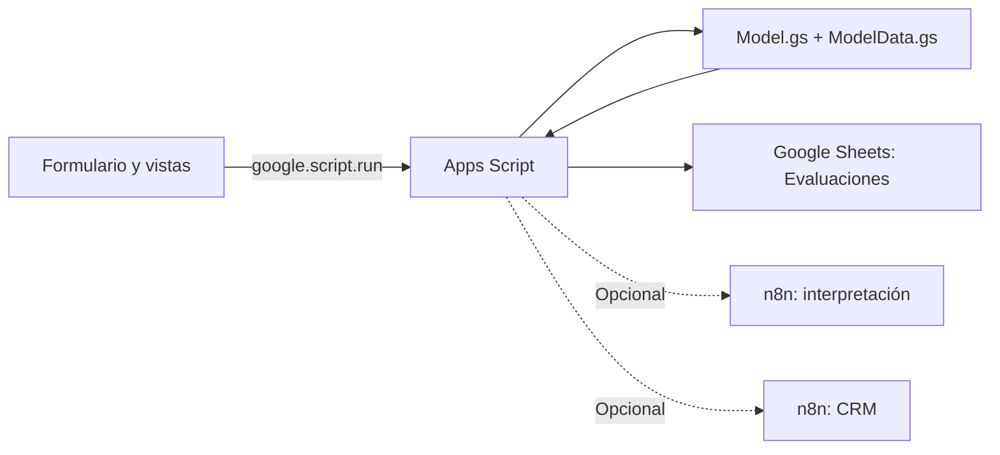

# Despliegue del modelo dentro de Google Apps Script

## Arquitectura vigente

Entrenamiento local en Python → exportación de parámetros → predicción en JavaScript dentro del servidor Apps Script.



No se despliega una API Node/Python. La carpeta `node-api/` es un antecedente de la implementación anterior y no interviene en este recorrido. n8n tampoco calcula ni cambia la predicción: recibe su resultado y la política de atención para interpretar o ejecutar acciones.

La exportación incluye el orden de columnas, categorías one-hot, medias y escalas, potencias de las interacciones, interceptos, coeficientes y orden de clases. No se copia el `.joblib` a Google ni se vuelve a entrenar en Apps Script.

## Archivos que deben existir en el editor remoto

En la carpeta local `onboarding-risk/apps-script/` están las versiones completas. Copiar cada contenido en el archivo remoto del mismo nombre y guardar. Respaldar previamente cualquier edición remota que no esté en la copia local.

| Archivo | Función |
|---|---|
| appsscript.json | Runtime V8, zona horaria y scopes de Sheets/solicitudes externas |
| Code.gs | Sirve la aplicación y coordina una evaluación con `predictRisk_` |
| Model.gs | Validación, transformaciones y predicción local |
| ModelData.gs | Parámetros exportados del modelo de 13 campos; no editar números a mano |
| ModelSmokeTest.gs | Función `testInstalledModel` para comprobar instalación sin escribir en Sheets ni llamar n8n |
| Repository.gs | Persistencia en la pestaña Evaluaciones |
| Integrations.gs | Solo llamadas opcionales a n8n |
| Index.html | Entrada HTML Service |
| Styles.html | Estilos compilados |
| Client.html | Frontend compilado con categorías y unidades corregidas |

Si `Code.gs` solo contiene `doGet` e `include`, la instalación está incompleta: también necesita `submitEvaluation`, consulta de histórico y reglas de atención. No añadir una segunda copia de esas funciones en otro archivo.

## Configuración inicial sin n8n

1. Abrir el proyecto Onboarding Risk existente en Google Apps Script.
2. Crear los tres archivos nuevos `Model`, `ModelData` y `ModelSmokeTest` de tipo Script; reemplazar los demás por sus versiones locales actuales y guardar todo.
3. Mantener `SPREADSHEET_ID` con el identificador de Histórico de Onboarding. La pestaña `Evaluaciones` debe tener once encabezados:

   `evaluationId, createdAt, clientName, projectName, owner, risk, modelVersion, route, crmStatus, evaluationJson, modelInputJson`.

4. No se necesitan `NODE_API_URL` ni `NODE_API_KEY`. El código actual no las consulta; pueden quedar sin configurar.
5. Dejar sin configurar las URLs de n8n para la primera prueba. Si ya están configuradas y activas, `submitEvaluation` sí las invocará: comprobar sus destinos antes de enviar una evaluación de prueba.
6. En el selector de funciones elegir `testInstalledModel` y pulsar Ejecutar. El resultado esperado es `ok: true`, `examples: 4` y error máximo de probabilidad menor que `1e-10`. No envía datos a servicios externos ni modifica el histórico.
7. Usar Implementar → Implementaciones de prueba → Aplicación web para probar la versión guardada (`/dev`, acceso de editores). Autorizar únicamente los permisos previstos del proyecto si Google los solicita.
8. Registrar un proyecto ficticio con los 13 campos. Verificar resultado real, versión `risk-logistic-13-…`, probabilidades y la nueva fila en Sheets. Sin n8n: interpretación `FALLBACK` y CRM `NOT_CONFIGURED`; la predicción y la ruta sí quedan registradas. Esto no significa que se haya creado una tarea en un CRM real.
9. Para entregar una versión estable, usar Implementar → Nueva implementación → Aplicación web. Elegir explícitamente identidad de ejecución y audiencia acordadas; no abrir acceso público por defecto. Para actualizar una implementación existente: Gestionar implementaciones → Editar → Nueva versión. La prueba `/dev` cambia con el código guardado; `/exec` corresponde a la versión desplegada.

## Conectar n8n después

Se interpreta «NHN» como n8n, por el contexto del resumen.

- `N8N_AGENT_URL` y `N8N_AGENT_TOKEN`: interpretación opcional; responde `{ "text": "…" }` o `{ "interpretation": "…" }`.
- `N8N_CRM_URL` y `N8N_CRM_TOKEN`: acción de CRM; responde `{ "status": "SUCCESS", "recordId": "…" }` o un estado explícito.

Los tokens permanecen en Script Properties, nunca en el HTML. Los workflows reciben `evaluationId` para deduplicar acciones. No se debe activar una acción duplicada en Apps Script y en n8n. Si la interpretación falla, se conserva una explicación de respaldo; si el CRM falla, queda pendiente y se conserva el riesgo estimado.

## Unidades y categorías

- Cinco numéricas: presupuesto en USD, duración en meses, tamaño del equipo, stakeholders y dependencias externas.
- Ocho categóricas: tipo de proyecto, experiencia del equipo, familiaridad tecnológica, estabilidad de requerimientos, respaldo ejecutivo, disponibilidad de stakeholders, madurez de procesos y madurez de gestión de riesgos.
- No se solicitan complejidad, historial de éxito, disponibilidad de recursos ni las otras variables de los experimentos ampliados. No se rellenan columnas omitidas.
- Las interacciones numéricas se calculan internamente después de estandarizar. No son preguntas adicionales.
- Los datos esenciales vacíos y las categorías desconocidas generan un error de validación; no se sustituyen por cero ni se interpretan como riesgo bajo.
- Los valores numéricos fuera del rango histórico producen `inputWarnings` en la evaluación; no se recortan a los mínimos o máximos observados.

## Reproducir la exportación y las pruebas localmente

Desde la carpeta de trabajo principal, con el entorno de modelos disponible:

```powershell
.\.venv_modelos\Scripts\python.exe .\onboarding-risk\scripts\export_apps_script_model.py
```

Desde `onboarding-risk`, con Node y pnpm disponibles:

```powershell
pnpm test:model
pnpm build
```

`tests/parity-report.json` documenta la equivalencia en las 4.000 filas, además de validaciones, interacciones numéricas y fallos de integración. Se ejecutó el código `.gs` real en un contexto JavaScript local con servicios Google simulados para las pruebas de flujo. Eso verifica lógica y paridad, pero no confirma permisos, guardado ni despliegue en Google: esos pasos se comprueban en el editor remoto.

## Límites del modelo

Se recuperó la logística de 13 campos de la búsqueda final del experimento 05 (C=3, interacciones numéricas de grado 2); esta exportación no modifica sus métricas. El procedimiento con 13 campos obtuvo macro-F1 anidado de aproximadamente 0,541 y accuracy de 0,541. En la referencia de 800 proyectos ya consultada, la configuración final obtuvo macro-F1 de 0,519 y accuracy de 0,520. Sus probabilidades no fueron calibradas. Las definiciones y la disponibilidad al ingreso de las 13 variables también deben validarse con negocio. La equivalencia Python/JavaScript confirma que se ejecuta el mismo modelo, no que sus predicciones sean siempre correctas.

Referencias: [aplicaciones web de Apps Script](https://developers.google.com/apps-script/guides/web), [runtime V8](https://developers.google.com/apps-script/guides/v8-runtime).
